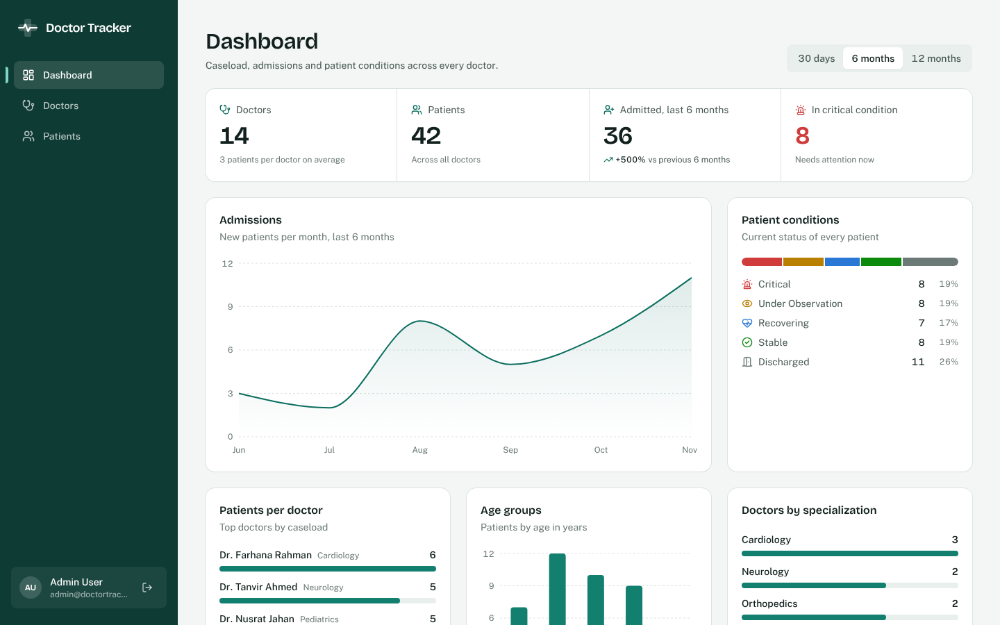
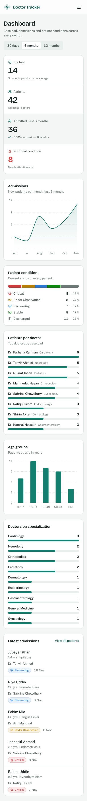

# Doctor Tracker API

REST API for **Doctor Tracker**, a secure admin portal for managing doctors and their patients.
Built with Node.js, Express 5, MongoDB (Mongoose) and TypeScript.

| | Link |
|---|---|
| Live API | `https://<your-render-service>.onrender.com` (health check at `/health`) |
| Live frontend | `https://<your-vercel-app>.vercel.app` |
| Frontend repository | `https://github.com/<your-username>/doctor-tracker-frontend` |

**Demo login:** `admin@doctortracker.com` / `Admin@12345`

## Description

Doctor Tracker gives hospital administrators one place to register doctors, assign and follow their
patients, and see how caseloads, admissions and patient conditions change over time. This repository is
the standalone Express API behind it: it authenticates admins with an httpOnly session cookie, validates
every request with Zod, serves searchable, filterable and paginated lists backed by purpose built MongoDB
indexes, and computes dashboard analytics with parallel aggregation pipelines.

## Setup guide

**Requirements:** Node.js 20.12 or newer, and MongoDB 6+ (local install or a free MongoDB Atlas cluster).

1. Install dependencies.
   ```bash
   npm install
   ```
2. Create your environment file and fill in the values.
   ```bash
   cp .env.example .env
   ```
   Set `MONGODB_URI` and replace `JWT_SECRET` with a random value of at least 32 characters
   (for example `openssl rand -hex 32`).
3. Seed the demo data. This creates the admin account, 14 doctors and 42 patients spread over the past
   year, and builds every index.
   ```bash
   npm run seed
   ```
4. Start the API in watch mode.
   ```bash
   npm run dev
   ```
   The API runs on `http://localhost:5000`. Check `http://localhost:5000/health`.
5. Start the frontend (see the frontend repository) and sign in with the demo account.

### Scripts

| Script | What it does |
|---|---|
| `npm run dev` | Start in watch mode with tsx |
| `npm run build` / `npm start` | Compile to `dist` and run the compiled server |
| `npm run seed` | Reset the database with demo data (refuses to run in production without `--force`) |
| `npm run db:indexes` | Create or update all indexes without touching data |
| `npm run typecheck` / `npm run lint` | Static checks |

### Environment variables

| Variable | Purpose | Default |
|---|---|---|
| `MONGODB_URI` | MongoDB connection string | required |
| `JWT_SECRET` | Secret used to sign session tokens, 32+ characters | required |
| `PORT` | HTTP port | `5000` |
| `SESSION_TTL_HOURS` | Session length | `24` |
| `CLIENT_ORIGINS` | Comma separated origins allowed by CORS | `http://localhost:3000` |
| `TRUST_PROXY_HOPS` | Reverse proxies in front of the API | `1` |
| `APP_TIMEZONE` | Time zone used to bucket dashboard dates | `Asia/Dhaka` |
| `SEED_ADMIN_*` | Name, email and password of the seeded admin | see `.env.example` |

### Deploying to Render (free tier)

1. Create a free MongoDB Atlas cluster and allow access from anywhere (`0.0.0.0/0`), since Render free
   instances do not have fixed outbound IPs.
2. Create a **Web Service** from this repository.
   - Build command: `npm ci --include=dev && npm run build`
   - Start command: `npm start`
   - Environment: `NODE_ENV=production`, `MONGODB_URI`, `JWT_SECRET`, `CLIENT_ORIGINS=https://<your-vercel-app>.vercel.app`
3. Seed the Atlas database once from your machine: put the Atlas URI in your local `.env` as
   `MONGODB_URI` and run `npm run seed`. This also creates every index (production runs with
   `autoIndex` off; `npm run db:indexes` rebuilds indexes without touching data).
4. Free Render services sleep after 15 minutes without traffic, so the first request can take up to a
   minute. Open `/health` once before a demo to wake it.

## System architecture

```mermaid
flowchart LR
    Browser["Browser<br/>(admin)"] -- "HTTPS, same origin<br/>/dashboard, /api/v1/*" --> Next["Next.js frontend<br/>(Vercel)"]
    Next -- "rewrite /api/* to API<br/>cookie passes through" --> API["Express API<br/>(Render)"]
    API --> MW["helmet, CORS, rate limit,<br/>JSON 10kb limit, cookie parser"]
    MW --> Auth["authenticate + authorize('admin')<br/>verify JWT, load user"]
    Auth --> Ctrl["Controllers<br/>Zod parse of params, query, body"]
    Ctrl --> Svc["Services<br/>query building, pagination, aggregation"]
    Svc --> DB[("MongoDB Atlas<br/>users, doctors, patients")]
```



**Request flow.** The browser only ever talks to the frontend's own domain. Next.js rewrites every
`/api/*` request to this API, so the session cookie set by `POST /api/v1/auth/login` is a first party,
httpOnly cookie on the frontend domain. Each protected request passes through security middleware,
then `authenticate` (verifies the JWT and loads the user, so a deleted account loses access at once) and
`authorize('admin')`. Controllers parse input with Zod, services build index friendly queries, and
responses use one envelope: `{ success, data, meta? }` or `{ success: false, message, errors? }`.

**Folder structure.** Each feature lives in `src/modules/<feature>` with its routes, controller, service
and validation schema. Shared code is in `src/utils` (pagination, search, dates), `src/validators`
(reusable Zod rules) and `src/middlewares`.

```
src/
  config/        env validation, database, session cookie settings
  constants/     enums shared by models, validation and the /meta endpoint
  middlewares/   auth, rate limiting, error handling
  models/        Mongoose schemas and indexes
  modules/       auth, doctors, patients, stats, meta
  utils/         pagination, keyword search, date buckets, responses
  validators/    reusable Zod field rules
  seed/          deterministic demo data
```

### Data model

| Collection | Fields | Indexes |
|---|---|---|
| `users` | name, email (unique), password (bcrypt, never selected), role | `email` |
| `doctors` | name, specialization (enum), hospital, phone, email (unique), keywords, timestamps | `email`, `keywords`, `{createdAt, _id}`, `{specialization, createdAt, _id}`, `{hospital, createdAt, _id}` |
| `patients` | name, age, gender, phone, email, bloodGroup, diagnosis, condition (enum), admittedAt, notes, doctor (ref), keywords, timestamps | `keywords`, `{doctor, admittedAt, _id}`, `{condition, admittedAt, _id}`, `{admittedAt, _id}` |

Patients reference their doctor by id instead of being embedded, because the patient list is paged,
searched and filtered on its own. Patient counts per doctor are computed with one grouped query per
page rather than stored, so they can never drift out of sync.

### API endpoints

All routes are prefixed with `/api/v1`. Everything except login and logout requires an admin session.

| Method | Path | Description |
|---|---|---|
| POST | `/auth/login` | Sign in, sets the session cookie (rate limited) |
| POST | `/auth/logout` | Clear the session cookie |
| GET | `/auth/me` | Current admin |
| GET | `/meta` | Enum options and hospital list for dropdowns |
| GET | `/stats/overview?range=30d\|6m\|12m` | Dashboard analytics |
| GET, POST | `/doctors` | List (search, specialization, hospital, from, to, sort, page, limit) and create |
| GET, PATCH, DELETE | `/doctors/:id` | Detail with condition breakdown, update, delete (removes their patients) |
| GET, POST | `/doctors/:id/patients` | A doctor's patients (same filters as below) and add a patient to that doctor |
| GET, POST | `/patients` | List (search, condition, gender, doctor, from, to, sort, page, limit) and create |
| GET, PATCH, DELETE | `/patients/:id` | Detail, update, delete |

## Technical decisions

### 1. Indexed keyword prefix search instead of `$regex` on each field or a `$text` index

**Problem.** Admins search as they type: "farh", "0171", "square hosp". The obvious query,
`{ $or: [{ name: /farh/i }, { hospital: /farh/i }, ...] }`, cannot use an index (unanchored,
case insensitive regex), so MongoDB scans every document on every keystroke. A `$text` index is
indexed, but it only matches whole stemmed words, so "farh" finds nothing.

**Decision.** Each doctor and patient stores a small `keywords` array: the lowercase words of the
searchable fields plus the digits of the phone number, maintained by a `pre('validate')` hook. A search
is split into words and turned into
`{ keywords: { $all: [/^farh/, /^squ/] } }`. Because every regex is anchored with `^` and case
sensitive against already lowercased data, MongoDB turns it into an index range scan on the multikey
`keywords` index (`IXSCAN keywords_1`, confirmed with `explain()`). User input is escaped before it is put
in a RegExp, so it cannot inject patterns or cause catastrophic backtracking, and at most five words are
used.

**Trade offs.** Matching is by word prefix, not by substring ("ahman" does not find "Rahman"), which
matches how people search names in practice. Writes do slightly more work to rebuild the array. On
Atlas, Atlas Search would add typo tolerance; this approach needs no extra service and works on any
MongoDB deployment, including the free tier.

**Related index choice.** Lists sort by date and then `_id` so pages are stable when two records share a
timestamp. Every compound index ends with `_id` (for example `{ condition: 1, admittedAt: -1, _id: -1 }`)
so MongoDB returns filtered results already in order (`FETCH <- IXSCAN`, no in memory `SORT` stage), and
the count for pagination runs in parallel on the same index.

### 2. Same origin proxy with an httpOnly cookie instead of a token in localStorage

**Problem.** The frontend (Vercel) and API (Render) live on different domains. The common shortcut is
to return a JWT, keep it in `localStorage` and send it as a header. Any XSS bug can then read and steal
the token. The alternative, a cross site cookie (`SameSite=None`), is increasingly blocked as a third
party cookie by Safari and Chrome.

**Decision.** The frontend rewrites `/api/*` to this API, so the browser sees one origin. On login the API
sets `dt_session` as `httpOnly`, `Secure` in production, `SameSite=Lax`. JavaScript can never read it, and
because it is first party no browser blocks it. Defence in depth around it:

- JWT verified with a pinned algorithm (`HS256`), issuer and audience; the user is reloaded on each request.
- Login is rate limited per IP and email, and unknown emails are compared against a dummy bcrypt hash so
  response time does not reveal which emails exist.
- CSRF: `SameSite=Lax` stops cross site POSTs, and the API only accepts JSON bodies, which HTML forms
  cannot send.
- Every body is a strict Zod object: unknown keys (mass assignment), objects in place of strings
  (`{"$ne": null}` operator injection) and angle brackets in any text field (stored XSS) are rejected with a
  400 before reaching the database. The query string parser is set to `simple`, so `?search[$ne]=x` is never
  turned into an object.
- `helmet` security headers, a 10kb body limit, and generic 500 messages in production.

**Trade off.** Every API call makes one extra hop through the frontend host. For an admin tool this costs
a few milliseconds and removes a whole class of token theft and cookie blocking problems.

### Smaller decisions

- **Dashboard analytics:** eleven small queries run in `Promise.all` instead of one large `$facet`.
  `$facet` sub pipelines cannot use indexes, while separate queries can (for example the timeline
  `$match` on `admittedAt`). Totals use `estimatedDocumentCount()`, which reads collection metadata.
  Timeline buckets are grouped in the configured time zone and empty days or months are filled with zero.
- **Validation as the contract:** controllers call `schema.parse()` and a central error handler turns
  Zod, duplicate key, cast and JSON errors into consistent 4xx responses.
- **Offset pagination** is used because admins jump to specific pages. The `paginate()` helper is shared
  by every list; switching a list to cursor pagination later would only change that helper.

## Visual evidence

Screenshots of the full interface (desktop and mobile) are in the frontend repository. Two highlights:

| Desktop | Mobile |
|---|---|
|  |  |
